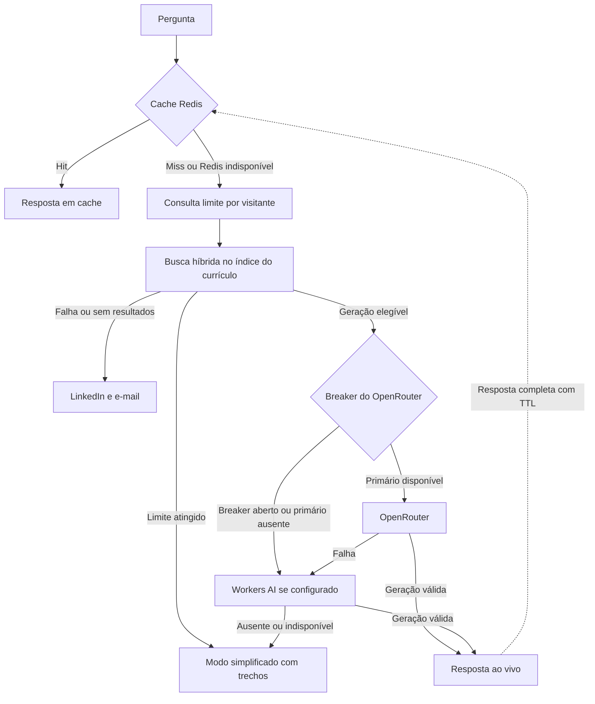

# Portfólio & Currículo Interativo com RAG & LLM | Elessandro Prestes Macedo

[](https://vuejs.org/)
[](https://tailwindcss.com/)
[](https://vitejs.dev/)
[](https://workers.cloudflare.com/)
[](https://openrouter.ai/)
[](https://www.docker.com/)
[](https://www.gnu.org/software/make/)
[](https://elessandroprestes.github.io/elessandrodev/)

---

## 📌 Sobre o Projeto

Este projeto consiste em uma Single Page Application (SPA) de alta performance que serve como portfólio profissional e currículo interativo de **Elessandro Prestes Macedo** (Senior Software Engineer & Tech Lead).

> 🌐 **Deploy em Produção (Live Demo):** [https://elessandroprestes.github.io/elessandrodev/](https://elessandroprestes.github.io/elessandrodev/)

Além de apresentar a trajetória de mais de **9 anos de experiência em engenharia de software e arquiteturas distribuídas**, a aplicação reflete como Elessandro aplica **Inteligência Artificial no seu ciclo de desenvolvimento utilizando SDD (Spec-Driven Development) e RAG (Retrieval-Augmented Generation)**, com um design system editorial sofisticado com suporte nativo a **Light Mode & Dark Mode** e **Internacionalização Bilíngue Completa (Português & Inglês)** com alternância fluida, detecção automática do navegador e persistência.

---

## 🧠 Arquitetura de IA: RAG real no Cloudflare Worker

O assistente usa **RAG** com corpus Markdown versionado. A pergunta é vetorizada no Worker, comparada ao índice por similaridade de cosseno e BM25, e apenas os trechos acima do threshold entram no prompt. A resposta cita as fontes consultadas.



As perguntas de contato recebem os canais diretamente. O restante usa busca híbrida
(cosseno + BM25) com os mesmos chunks, limiar e ranking. A busca acontece uma vez por
miss e fornece o contexto para ambos os LLMs e os trechos para o modo simplificado.
O limite é consultado após o cache e, se atingido, bloqueia a geração. O breaker
reserva a sondagem imediatamente antes da geração, com os trechos disponíveis.

### Qualidade do retrieval

- `npm run rag:eval`: **100% hit@4**, MRR **0.975**, cobertura do threshold **100%**.
- `npm run rag:check`: valida `sourceHash`, dimensões e consistência do índice no CI.

### Decisões de resiliência (SPEC-016)

- **Upstash Redis via HTTPS.** O Cloudflare Worker usa `fetch` nativo e compartilha
  o estado entre instâncias. Redis em Docker exigiria um serviço de rede operado
  à parte. LRU ficaria restrito à instância e Workers KV oferece consistência
  eventual para chaves que precisam de operações atômicas. Com a hipótese de
  100 consultas diárias e cinco comandos por consulta, a estimativa é de
  15 mil comandos por mês. O volume real será observado após a publicação.
- **Cache por revisão.** A chave combina versão do esquema, `sourceHash`,
  data da indexação, modelo de embedding, idioma e hash da pergunta normalizada.
  A troca do índice publicado muda o prefixo, e as chaves anteriores expiram pelo
  TTL. O registro contém texto, fontes, origem, provedor e timestamp. Respostas
  sem evidência de completude ficam fora do cache.
- **Coordenação e contingência.** Operações atômicas no Redis controlam o contador
  por visitante e concedem uma sondagem por vez após o cooldown. Na falha do Redis,
  o Worker usa o breaker local à instância e o limite nativo da Cloudflare.
  O limite protege a geração. A busca simplificada ainda usa embeddings.
- **Métricas por eventos.** Workers Logs permite contar hits, misses, tentativas
  por provedor, estados do breaker e origens das respostas pelo log JSON. O
  `requestId` correlaciona as etapas. Perguntas, IPs e detalhes dos provedores
  ficam fora dos logs emitidos pelo Worker.

**Evolução proposta.** Se houver muitos misses por paráfrase, avaliar um cache
semântico com embedding da pergunta e similaridade dentro do idioma e da versão
do índice. Medir ganho de hits, falsos positivos entre empresas e projetos,
latência e consumo de embeddings. O cache exato continua respondendo antes de
toda chamada de IA.

---

## 🛠️ Stack Tecnológica

| Camada | Tecnologia | Descrição |
|---|---|---|
| **Frontend Framework** | **Vue.js 3** | Composition API, `<script setup>`, reatividade granular |
| **Estilização & Temas** | **Tailwind CSS + PostCSS** | Design System editorial adaptativo (Light & Dark Mode), WCAG 2.1 AA |
| **IA & Metodologia** | **SDD + RAG** | Aplicação de IA no ciclo de desenvolvimento com Spec-Driven Development e RAG |
| **Build & Bundle Tool** | **Vite** | HMR ultrarrápido, otimização de assets e build modular com Rollup |
| **Backend de IA** | **Cloudflare Workers** | CORS, prompt grounded, cache e fallback de provedor |
| **Embeddings** | **Cloudflare Workers AI** | `@cf/baai/bge-m3` para indexação e consulta |
| **Modelo de Linguagem (LLM)** | **OpenRouter + Workers AI** | Cadeia gratuita com fallback para Workers AI em 429/5xx |
| **Cache** | **Upstash Redis** | Cache por revisão, circuit breaker e limite por visitante |
| **Recuperação** | **RAG híbrido** | Cosseno + BM25, threshold e citação de fontes |
| **Padronização de Comandos** | **GNU Make** | Automação unificada de tarefas via `Makefile` |
| **Containerização** | **Docker & Compose** | Ambientes de desenvolvimento e execução isolados e replicáveis |
| **Hospedagem & CI/CD** | **GitHub Pages & Actions** | Deploy automatizado de artefatos estáticos |

---

## ⚙️ Configuração do Ambiente

### 1. Pré-requisitos
- [Docker](https://www.docker.com/) e [Docker Compose](https://docs.docker.com/compose/) **OU** [Node.js (>= 18)](https://nodejs.org/) com [npm](https://www.npmjs.com/).
- [GNU Make](https://www.gnu.org/software/make/) instalado (padrão em sistemas Linux e macOS).
- Uma conta Cloudflare com **Workers AI** habilitado.
- Uma chave da **OpenRouter** apenas para configurar o secret do Worker.

### 2. Variáveis de Ambiente
Copie o arquivo de exemplo. O frontend só precisa da URL pública do Worker:

```bash
cp .env.example .env
```

```dotenv
VITE_CHAT_API_URL=https://elessandrodev-chat.elessandrodev.workers.dev
VITE_LLM_MAX_RETRIES=2
VITE_LLM_TIMEOUT_MS=35000
VITE_LLM_BACKOFF_BASE_MS=500
```

Configure as credenciais no Worker. Para desenvolvimento local, use `.dev.vars`:

```bash
npx wrangler login
npx wrangler secret put OPENROUTER_API_KEY
npx wrangler secret put UPSTASH_REDIS_REST_URL
npx wrangler secret put UPSTASH_REDIS_REST_TOKEN
npx wrangler secret put VISITOR_HASH_SECRET
npx wrangler deploy
```

Variáveis não sensíveis do Worker (em `wrangler.toml`):

| Variável | Padrão | Função |
|---|---|---|
| `MODELS` | cadeia `:free` | Modelos da OpenRouter, em ordem de preferência |
| `WORKERS_AI_MODEL` | `@cf/google/gemma-4-26b-a4b-it` | Modelo de fallback quando a OpenRouter falha. Vazio desativa o fallback de geração |
| `WORKER_BUDGET_MS` | `25000` | Orçamento para iniciar e executar chamadas de IA no Worker |
| `MIN_CALL_BUDGET_MS` | `2000` | Margem mínima para iniciar uma chamada |
| `OPENROUTER_TIMEOUT_MS` | `8000` | Timeout por modelo da OpenRouter |
| `WORKERS_AI_TIMEOUT_MS` | `12000` | Timeout do fallback Workers AI |
| `OPENROUTER_MAX_TOKENS` | `3000` | Tokens de saída da OpenRouter |
| `WORKERS_AI_MAX_TOKENS` | `768` | Tokens de saída do fallback |
| `CIRCUIT_BREAKER_THRESHOLD` | `3` | Falhas consecutivas para abrir o breaker |
| `CIRCUIT_BREAKER_MS` | `60000` | Janela de exclusão do breaker |
| `REDIS_TIMEOUT_MS` | `500` | Timeout por operação Redis |
| `EMBEDDING_TIMEOUT_MS` | `5000` | Timeout do embedding da pergunta |
| `CHAT_RATE_LIMIT_MAX` | `10` | Máximo de consultas inéditas que podem gerar por visitante e janela |
| `CHAT_RATE_LIMIT_WINDOW_SECONDS` | `60` | Janela do contador Redis |
| `CACHE_TTL_SECONDS` | `86400` | TTL do cache RAG-aware |
| `ENABLE_CACHE` | `true` | Desativa o cache de respostas com `false` |

Para atualizar o corpus:

```bash
npm run rag:index
npm run rag:eval
npm run rag:check
npx wrangler deploy
```

Gere um valor aleatório para `VISITOR_HASH_SECRET` e configure o mesmo valor em
todas as instâncias que compartilham o contador. Use um banco Redis separado
para cada ambiente. O Workers AI usa Gemma 4 26B, substituto recomendado pela
Cloudflare para modelos descontinuados e disponível no plano gratuito. A cota
de Workers AI é compartilhada com os embeddings.
[Modelos descontinuados](https://developers.cloudflare.com/changelog/post/2026-11-05-planned-model-deprecations/) ·
[Disponibilidade no plano gratuito](https://developers.cloudflare.com/changelog/post/2026-07-28-models-require-workers-paid/)

Para aquecer o cache após publicar o índice, defina `CHAT_WARMUP_URL` com o
endpoint e `CHAT_WARMUP_ORIGIN` com uma origem permitida. Execute:

```bash
npm run rag:warm
```

O comando envia as perguntas dos chips PT/EN em sequência. Consome cota nas
perguntas inéditas e informa se alguma consulta ficou sem resposta cacheada.
As perguntas de contato são atendidas diretamente. Veja como simular as falhas
localmente em [Operações](docs/operations.md#simulações-locais).

### 3. Worker Local (opcional)

Para testar o assistente sem publicar o Worker:

```bash
# .dev.vars (ignorado pelo Git): chave da OpenRouter
OPENROUTER_API_KEY=sua-chave-local

# .env.local (ignorado pelo Git): aponta o frontend para o Worker local
VITE_CHAT_API_URL=http://127.0.0.1:8788
```

```bash
npx wrangler dev --port 8788 --ip 127.0.0.1
npm run dev
```

O frontend usa o Worker local em `http://127.0.0.1:8788` e a aplicação continua em `http://localhost:5212/elessandrodev/`.


---

## 🚀 Como Executar o Projeto

A automação do ciclo de desenvolvimento e build é gerenciada via **Makefile**.

### Guia Rápido com Makefile

```bash
# 1. Exibir todos os comandos disponíveis
make help

# 2. Configurar o ambiente inicial (cria .env e instala dependências)
make setup

# 3. Executar o ambiente com Docker Compose:
make up

# OU executar localmente no Node/Vite (modo host):
make dev
```

Acesse a aplicação no navegador em: **`http://localhost:5212/elessandrodev/`**.

---

## 📋 Catálogo de Comandos do Makefile

Execute `make help` a qualquer momento para listar os alvos documentados:

```
Uso: make [alvo]

Alvos disponíveis:

Ajuda
  help                Exibe esta mensagem de ajuda

Configuração & Instalação
  setup               Configura o ambiente inicial (.env a partir do .env.example) e instala dependências
  install             Instala dependências do projeto via npm
  install-clean       Reinstala dependências do zero

Desenvolvimento Local
  dev                 Inicia o servidor de desenvolvimento Vite localmente
  build               Gera o build estático de produção (dist/)
  preview             Visualiza localmente o build de produção
  clean               Limpa a pasta de build gerada (dist/)

Docker & Containers
  up                  Inicia os containers Docker em segundo plano
  down                Para e remove os containers Docker
  restart             Reinicia os containers Docker
  logs                Exibe os logs dos containers em tempo real
  build-docker        Reconstrói as imagens Docker sem cache
  shell               Abre um terminal interativo dentro do container da aplicação
  ps                  Lista o status dos containers Docker do projeto
```

---

## 📦 Build e Deploy

- **Deploy Automático (CI/CD):** Todo push ou merge na branch `main` dispara o pipeline no GitHub Actions e publica automaticamente em:  
  👉 **[https://elessandroprestes.github.io/elessandrodev/](https://elessandroprestes.github.io/elessandrodev/)**

- **Build Manual Local:** Para gerar o pacote estático otimizado para produção localmente:

```bash
make build
```

Os artefatos minificados e otimizados serão gerados no diretório `dist/`, incluindo a versão atualizada do currículo em PDF ([`Elessandro_Prestes_Macedo_Software_Engineer.pdf`](file:///home/elessandro/Área de Trabalho/Dev/Elessandro/elessandrodev/public/Elessandro_Prestes_Macedo_Software_Engineer.pdf)).

---

## 📬 Contato & Redes Profissionais

| Canal | Link |
|---|---|
| **Deploy / Portfólio Online** | [elessandroprestes.github.io/elessandrodev](https://elessandroprestes.github.io/elessandrodev/) |
| **LinkedIn** | [linkedin.com/in/elessandro-prestes-macedo](https://www.linkedin.com/in/elessandro-prestes-macedo/) |
| **GitHub** | [github.com/ElessandroPrestes](https://github.com/ElessandroPrestes) |
| **GitLab** | [gitlab.com/elessandrodev](https://gitlab.com/elessandrodev) |
| **WhatsApp** | [+55 (45) 99917-8290](https://wa.me/5545999178290) |
| **E-mail** | [elessandrodev@gmail.com](mailto:elessandrodev@gmail.com) |

---

<div align="center">
  <sub>Desenvolvido com foco em alta performance, arquitetura limpa e inteligência artificial aplicada por <strong>Elessandro Prestes Macedo</strong>.</sub>
</div>


