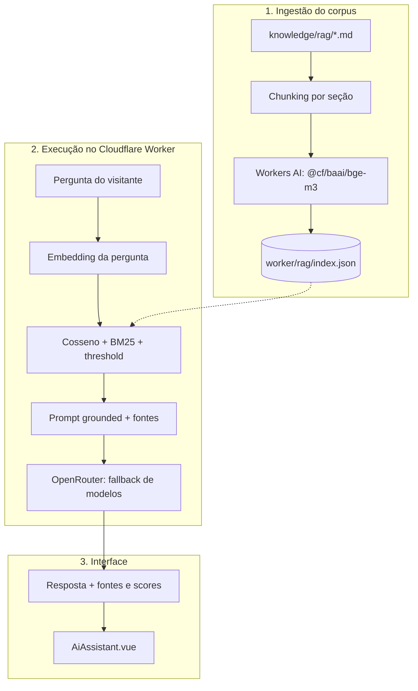

# Portfólio & Currículo Interativo com RAG & LLM | Elessandro Prestes Macedo

[](https://vuejs.org/)
[](https://tailwindcss.com/)
[](https://vitejs.dev/)
[](https://workers.cloudflare.com/)
[](https://openrouter.ai/)
[](https://www.docker.com/)
[](https://www.gnu.org/software/make/)
[](https://elessandroprestes.github.io/elessandrodev/)

---

## 📌 Sobre o Projeto

Este projeto consiste em uma Single Page Application (SPA) de alta performance que serve como portfólio profissional e currículo interativo de **Elessandro Prestes Macedo** (Senior Software Engineer & Tech Lead).

> 🌐 **Deploy em Produção (Live Demo):** [https://elessandroprestes.github.io/elessandrodev/](https://elessandroprestes.github.io/elessandrodev/)

Além de apresentar a trajetória de mais de **9 anos de experiência em engenharia de software e arquiteturas distribuídas**, a aplicação reflete como Elessandro aplica **Inteligência Artificial no seu ciclo de desenvolvimento utilizando SDD (Spec-Driven Development) e RAG (Retrieval-Augmented Generation)**, com um design system editorial sofisticado com suporte nativo a **Light Mode & Dark Mode** e **Internacionalização Bilíngue Completa (Português & Inglês)** com alternância fluida, detecção automática do navegador e persistência.

---

## 🧠 Arquitetura de IA: RAG real no Cloudflare Worker

O assistente usa **RAG** com corpus Markdown versionado. A pergunta é vetorizada no Worker, comparada ao índice por similaridade de cosseno e BM25, e apenas os trechos acima do threshold entram no prompt. A resposta cita as fontes consultadas.



### Pilares da solução:

1. **Corpus estruturado:** `knowledge/rag/` cobre perfil, experiências, projetos e FAQ, com aliases em PT/EN.
2. **Retrieval híbrido:** cosseno + BM25 (`HYBRID_ALPHA=0.6`, `TOP_K=4`, `MIN_SCORE=0.45`).
3. **Grounded answer:** o Worker envia apenas os chunks recuperados e instrui o modelo a não inventar fatos.
4. **Fallback sem LLM:** se nada atinge o threshold, a resposta é gerada sem chamada ao provedor.
5. **Segurança:** a chave da OpenRouter fica como secret do Worker; o frontend envia apenas `{ question, locale }`.

### Qualidade do retrieval

- `npm run rag:eval`: **100% hit@4**, MRR **0.975**, cobertura do threshold **100%**.
- `npm run rag:check`: valida `sourceHash`, dimensões e consistência do índice no CI.

---

## 🛠️ Stack Tecnológica

| Camada | Tecnologia | Descrição |
|---|---|---|
| **Frontend Framework** | **Vue.js 3** | Composition API, `<script setup>`, reatividade granular |
| **Estilização & Temas** | **Tailwind CSS + PostCSS** | Design System editorial adaptativo (Light & Dark Mode), WCAG 2.1 AA |
| **IA & Metodologia** | **SDD + RAG** | Aplicação de IA no ciclo de desenvolvimento com Spec-Driven Development e RAG |
| **Build & Bundle Tool** | **Vite** | HMR ultrarrápido, otimização de assets e build modular com Rollup |
| **Backend de IA** | **Cloudflare Workers** | CORS, prompt grounded, retries e fallback de modelos |
| **Embeddings** | **Cloudflare Workers AI** | `@cf/baai/bge-m3` para indexação e consulta |
| **Modelo de Linguagem (LLM)** | **OpenRouter** | Cadeia de modelos gratuitos com fallback |
| **Recuperação** | **RAG híbrido** | Cosseno + BM25, threshold e citação de fontes |
| **Padronização de Comandos** | **GNU Make** | Automação unificada de tarefas via `Makefile` |
| **Containerização** | **Docker & Compose** | Ambientes de desenvolvimento e execução isolados e replicáveis |
| **Hospedagem & CI/CD** | **GitHub Pages & Actions** | Deploy automatizado de artefatos estáticos |

---

## ⚙️ Configuração do Ambiente

### 1. Pré-requisitos
- [Docker](https://www.docker.com/) e [Docker Compose](https://docs.docker.com/compose/) **OU** [Node.js (>= 18)](https://nodejs.org/) com [npm](https://www.npmjs.com/).
- [GNU Make](https://www.gnu.org/software/make/) instalado (padrão em sistemas Linux e macOS).
- Uma conta Cloudflare com **Workers AI** habilitado.
- Uma chave da **OpenRouter** apenas para configurar o secret do Worker.

### 2. Variáveis de Ambiente
Copie o arquivo de exemplo. O frontend só precisa da URL pública do Worker:

```bash
cp .env.example .env
```

```dotenv
VITE_CHAT_API_URL=https://elessandrodev-chat.elessandrodev.workers.dev
VITE_LLM_MAX_RETRIES=2
VITE_LLM_TIMEOUT_MS=30000
VITE_LLM_BACKOFF_BASE_MS=500
```

A chave da OpenRouter não vai no `.env` do frontend. Configure-a como secret do Worker:

```bash
npx wrangler login
npx wrangler secret put OPENROUTER_API_KEY
npx wrangler deploy
```

Para atualizar o corpus:

```bash
npm run rag:index
npm run rag:eval
npm run rag:check
npx wrangler deploy
```

---

## 🚀 Como Executar o Projeto

A automação do ciclo de desenvolvimento e build é gerenciada via **Makefile**.

### Guia Rápido com Makefile

```bash
# 1. Exibir todos os comandos disponíveis
make help

# 2. Configurar o ambiente inicial (cria .env e instala dependências)
make setup

# 3. Executar o ambiente com Docker Compose:
make up

# OU executar localmente no Node/Vite (modo host):
make dev
```

Acesse a aplicação no navegador em: **`http://localhost:5212/elessandrodev/`**.

---

## 📋 Catálogo de Comandos do Makefile

Execute `make help` a qualquer momento para listar os alvos documentados:

```
Uso: make [alvo]

Alvos disponíveis:

Ajuda
  help                Exibe esta mensagem de ajuda

Configuração & Instalação
  setup               Configura o ambiente inicial (.env a partir do .env.example) e instala dependências
  install             Instala dependências do projeto via npm
  install-clean       Reinstala dependências do zero

Desenvolvimento Local
  dev                 Inicia o servidor de desenvolvimento Vite localmente
  build               Gera o build estático de produção (dist/)
  preview             Visualiza localmente o build de produção
  clean               Limpa a pasta de build gerada (dist/)

Docker & Containers
  up                  Inicia os containers Docker em segundo plano
  down                Para e remove os containers Docker
  restart             Reinicia os containers Docker
  logs                Exibe os logs dos containers em tempo real
  build-docker        Reconstrói as imagens Docker sem cache
  shell               Abre um terminal interativo dentro do container da aplicação
  ps                  Lista o status dos containers Docker do projeto
```

---

## 📦 Build e Deploy

- **Deploy Automático (CI/CD):** Todo push ou merge na branch `main` dispara o pipeline no GitHub Actions e publica automaticamente em:  
  👉 **[https://elessandroprestes.github.io/elessandrodev/](https://elessandroprestes.github.io/elessandrodev/)**

- **Build Manual Local:** Para gerar o pacote estático otimizado para produção localmente:

```bash
make build
```

Os artefatos minificados e otimizados serão gerados no diretório `dist/`, incluindo a versão atualizada do currículo em PDF ([`Elessandro_Prestes_Macedo_Software_Engineer.pdf`](file:///home/elessandro/Área de Trabalho/Dev/Elessandro/elessandrodev/public/Elessandro_Prestes_Macedo_Software_Engineer.pdf)).

---

## 📬 Contato & Redes Profissionais

| Canal | Link |
|---|---|
| **Deploy / Portfólio Online** | [elessandroprestes.github.io/elessandrodev](https://elessandroprestes.github.io/elessandrodev/) |
| **LinkedIn** | [linkedin.com/in/elessandro-prestes-macedo](https://www.linkedin.com/in/elessandro-prestes-macedo/) |
| **GitHub** | [github.com/ElessandroPrestes](https://github.com/ElessandroPrestes) |
| **GitLab** | [gitlab.com/elessandrodev](https://gitlab.com/elessandrodev) |
| **WhatsApp** | [+55 (45) 99917-8290](https://wa.me/5545999178290) |
| **E-mail** | [elessandrodev@gmail.com](mailto:elessandrodev@gmail.com) |

---

<div align="center">
  <sub>Desenvolvido com foco em alta performance, arquitetura limpa e inteligência artificial aplicada por <strong>Elessandro Prestes Macedo</strong>.</sub>
</div>


