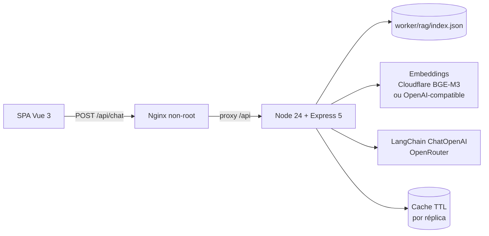

# Arquitetura da Migração — Backend Node.js

> Documento da SPEC-015. Complementa `docs/architecture.md`, que descreve a
> operação vigente em Cloudflare. Nada aqui altera produção nesta branch.

## 1. Visão geral

O contrato externo permanece `{ question, locale } → { response, sources }`.
Metadados de diagnóstico saem em `X-Request-Id`, `X-Assistant-Stage`,
`X-Assistant-Cache` e `X-Assistant-Provider`.

## 2. Módulos do backend

| Módulo | Responsabilidade |
|---|---|
| `config/env.ts` | Validação Zod, defaults e parsing de listas/booleanos |
| `rag/index-loader.ts` | Leitura e validação do índice existente |
| `rag/json-vector-store.ts` | Vetores, BM25 e metadados do índice |
| `rag/hybrid-json-retriever.ts` | Retriever híbrido exposto ao LangChain |
| `rag/context.ts` | Montagem de contexto e fontes |
| `embeddings/*` | Cloudflare BGE-M3, OpenAI-compatible, factory e retry |
| `llm/prompt.ts` | Prompt grounded portado do Worker |
| `llm/langchain-openrouter.client.ts` | Cadeia de modelos, timeout, retry e circuit breaker |
| `llm/mock.client.ts` | Modo determinístico para testes |
| `chat/chat.service.ts` | Orquestração, cache, contato e fallback |
| `chat/answer-cache.ts` | Cache TTL positivo e negativo |
| `health/health.routes.ts` | `/health` e `/ready` |
| `middleware/*` | request-id, logs Pino, erros, rate limit e 404 |
| `security/cors.ts` | Allowlist de origem e headers expostos |
| `shared/*` | erros, retry, timeout, circuit breaker, hash, logger e texto |

## 3. Fluxo de uma pergunta

1. Express valida o corpo (`question` e `locale` opcional).
2. O service normaliza idioma e calcula o hash da pergunta.
3. Pergunta de contato recebe resposta determinística sem provedor.
4. Cache positivo é consultado por hash + `sourceHash` do índice.
5. Embedding da pergunta com timeout; erro vira `503` controlado.
6. Retriever híbrido aplica cosseno + BM25, `alpha`, `topK` e `minScore`.
7. Sem chunks acima do threshold, retorna fallback seguro sem LLM.
8. Prompt grounded é montado com contexto e regras de fidelidade.
9. Cadeia de modelos roda com orçamento total, retry e circuit breaker.
10. Resposta é sanitizada, cacheada e devolvida com fontes e headers.

## 4. Decisões relacionadas

- ADR-010 — Node.js + TypeScript + Express.
- ADR-011 — LangChain.js restrito à integração.
- ADR-012 — Kubernetes com Kustomize.
- ADR-009 — herança de timeouts, fallback e observabilidade.

## 5. Limites conhecidos

- Cache, rate limit e circuit breaker são locais à réplica.
- O índice é empacotado na imagem; reindexar exige novo build.
- O Worker permanece como rollback até a validação em produção.
